<div align="center">

# 🏴‍☠️ Уровень One Piece на графике вкладов GitHub


[](https://github.com/rakhmanov-tr/Onepiece-Contribution-Graph/actions)

---

### ⚓ Преврати график вкладов GitHub в живую палубу пиратского корабля

Python-скрипт и GitHub Actions забирают календарь вкладов через GitHub GraphQL API. Скрипт считает путь по неделям: пират вылезает из бочки SAKE, прыгает по самым высоким клеткам, собирает мясо в самые насыщенные дни и доходит до штурвала.

[**Сообщить о баге**](https://github.com/rakhmanov-tr/Onepiece-Contribution-Graph/issues) • [**Политика безопасности**](SECURITY.md)

</div>

---

## 🚀 Как это выглядит

<picture>
  
</picture>

---

## 🌟 Что умеет уровень

| Возможность | Как это работает |
|---|---|
| 🏃‍♂️ **Паркур по клеткам** | Пират не бежит по прямой. На каждой неделе он встаёт на самую высокую непустую клетку и перепрыгивает, если высота меняется. |
| 🍖 **Мясо** | Самые насыщенные дни (уровень 4) ставят мясо на клетку. Пират подбирает его, когда проходит мимо: кусок поднимается и исчезает. |
| 🏴 **Финиш у штурвала** | Он вылезает из бочки, проходит год, соскальзывает по мачте и доходит до штурвала. Смотровой в это же окно спускается с марса на палубу. |
| ☁️ **Палуба и небо** | Голубое небо, плывущие облака, мандариновые кусты по краю палубы, доски, мачта с вантами, марсовая площадка и штурвал. |
| 🛡️ **Чистый SVG** | Весь рисунок собран из SVG, без внешних картинок. Один проход длится 20 секунд и крутится сам. |

---

## 🛠️ Как поставить себе

Файл `generate.py` уже лежит в этом репозитории. Его можно скопировать в свой репозиторий или сделать форк: workflow сам возьмёт логин владельца репозитория.

### 1. Скрипт

Положи в репозиторий файл `generate.py` из этого репозитория.

Проверить локально:

```bash
python generate.py --user YOUR_USERNAME
```

Команда пишет `onepiece_contribution.svg` в корень. Страница [`preview/index.html`](preview/index.html) показывает этот файл.

### 2. Автоматизация

Создай файл `.github/workflows/onepiece-graph.yml`:

```yaml
name: Generate One Piece Contribution Graph

on:
  schedule:
    - cron: "0 0 * * *" # каждый день в полночь UTC
  workflow_dispatch:    # ручной запуск

jobs:
  build:
    runs-on: ubuntu-latest
    permissions:
      contents: write
    steps:
      - name: Checkout repository
        uses: actions/checkout@v4

      - name: Set up Python
        uses: actions/setup-python@v5
        with:
          python-version: "3.12"

      - name: Generate One Piece SVG
        env:
          GITHUB_TOKEN: ${{ secrets.GITHUB_TOKEN }}
          GITHUB_ACTOR: ${{ github.repository_owner }}
        run: python generate.py

      - name: Commit and push SVG
        run: |
          git config user.name "github-actions[bot]"
          git config user.email "41898282+github-actions[bot]@users.noreply.github.com"
          git add onepiece_contribution.svg
          git commit -m "Update One Piece contribution graph" || echo "No changes to commit"
          git push
```

Workflow запускается по расписанию и вручную. Он коммитит `onepiece_contribution.svg` в ветку `main`. Отдельная ветка для картинки не нужна.

### 3. Права на запись

1. Открой **Settings → Actions → General**.
2. В блоке **Workflow permissions** выбери **Read and write permissions**.
3. Нажми **Save**.

### 4. Первый запуск

Открой вкладку **Actions**, выбери **Generate One Piece Contribution Graph** и нажми **Run workflow**. Когда сборка закончится, в корне `main` появится `onepiece_contribution.svg`.

---

## 🖼️ Как показать на профиле

Вставь это в `README.md` своего профиля. Замени `YOUR_USERNAME` и `YOUR_REPO`:

```html
<div align="center">
  <a href="https://github.com/YOUR_USERNAME/YOUR_REPO">
    
  </a>
</div>
```

---

## 🎨 Что можно поменять

Всё в `generate.py`:

- **Скорость.** `LOOP_SECONDS` — длина одного прохода, сейчас 20 секунд.
- **Пират.** `RUNNER_PIXELS` и `RUNNER_COLORS`: каждый символ в строке — один пиксель.
- **Декор.** `CLOUD_PIXELS`, `BUSH_PIXELS`, `MEAT_PIXELS`, `LOOKOUT_PIXELS` — облака, мандариновые кусты, мясо и смотровой.
- **Корабль.** Бочка, палуба, мачта и штурвал нарисованы фигурами ниже по файлу.
- **Небо.** Цвет класса `.bg` в стилях SVG.

---

## 🤝 Основа

Идея уровня и расчёт пути взяты из [sapthesh/Mario-Contribution-Graph](https://github.com/sapthesh/Mario-Contribution-Graph) (MIT, Copyright (c) 2026 Sapthesh V). Спрайт пирата в этой копии свой.

<div align="center">

Сделано по мотивам Mario Contribution Graph · [MIT](LICENSE)

</div>
